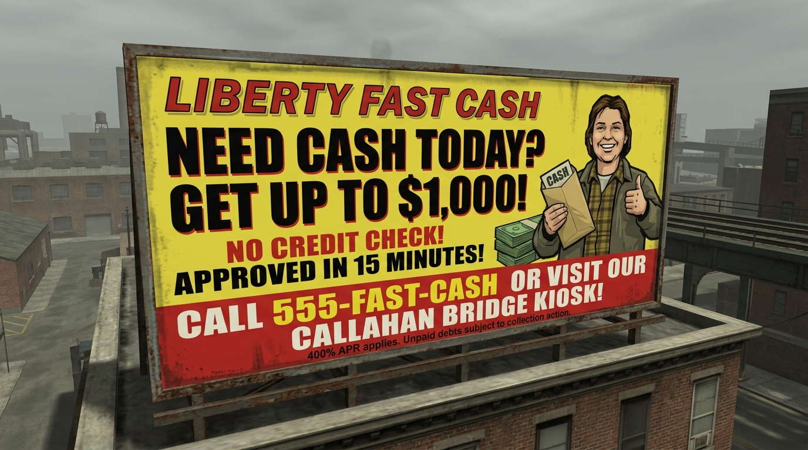
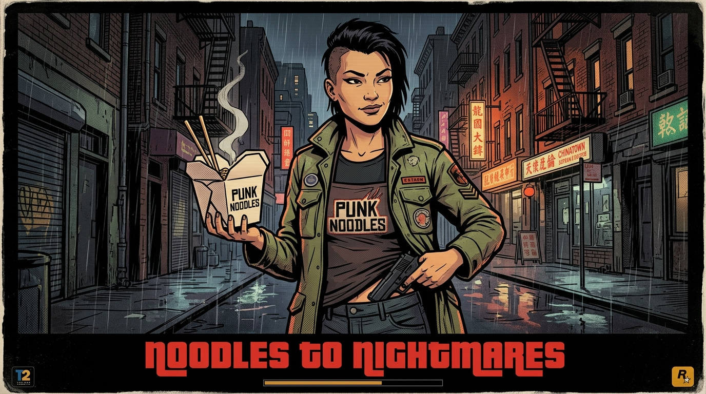

# Billboards & Key Art Specifications

## 1. Rooftop Billboard (Rosa's Apartment)

### Concept: "Liberty Fast Cash"
- **Placement**: Custom rooftop billboard structure atop Rosa's apartment building in North Portland.
- **Tone**: Authentic high-impact commercial payday loan billboard with 2001 GTA parody edge.
- **Copy**:
  - *Headline*: "NEED CASH TODAY? GET UP TO $1,000!"
  - *Subheading*: "NO CREDIT CHECK! APPROVED IN 15 MINUTES!"
  - *Call to Action (CTA)*: "CALL 555-FAST-CASH OR VISIT OUR CALLAHAN BRIDGE KIOSK!"
  - *Fine Print*: "400% APR applies. Unpaid debts subject to collection action."
- **Visual**:

---

## 2. Key Art & Mission Splash Screen

### Concept: Rosa Chang ("Noodles to Nightmares")
- **Style**: Canonical Stephen Bliss GTA III comic-strip key art (thick black ink contours, cel-shaded tones, halftone dot texture).
- **Subject**: Rosa Chang (23, mixed Chinese-Spanish) in her Punk Noodles work uniform with an olive jacket, holding steaming takeout in one hand and a concealed sidearm in the other.
- **Application**: Title screen, loading screens, and Act transition splash cards.
- **Visual**:

---

## 3. Additional In-Universe Billboard Candidates

| Island | Location | Brand / Ad Concept | Narrative Purpose |
| :--- | :--- | :--- | :--- |
| **Portland** | Chinatown Archway | **Punk Noodles**: *"Slurp Loud, Die Young"* | Local neighborhood identity and day-job anchor |
| **Portland** | Trenton / Harbor Expressway | **Dormatron**: *"Why Suffer Insomnia When You Can Go Comatose?"* | Radio-ad brand callback for period continuity |
| **Staunton Island** | Torrington Financial | **Bitch'n' Dog Food**: *"It's meaty!"* | Classic GTA III mafia front company billboard |
| **Shoreside Vale** | Pike Creek Approach | **Love Media**: *"Freedom of Speech, Pending Approval"* | Donald Love conglomerate presence overlooking industrial sector |
